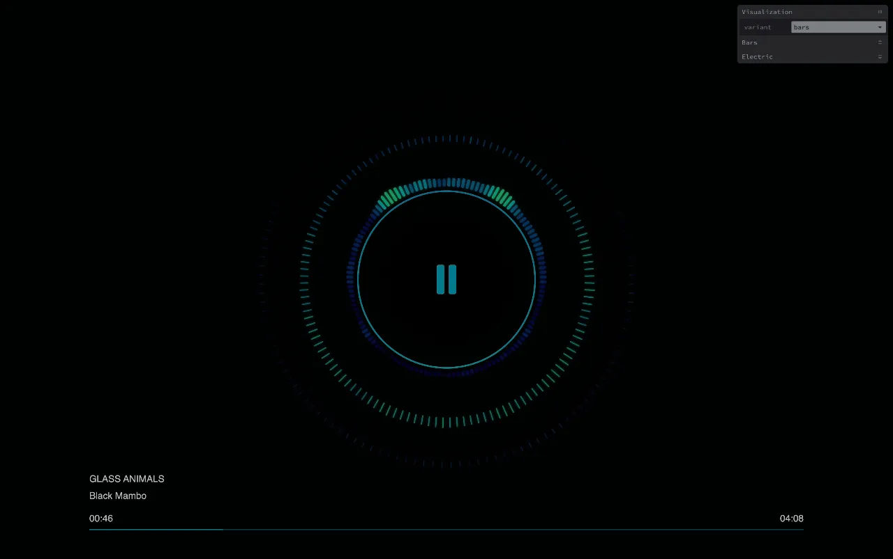

# [YAAV](https://wolfpilot.github.io/YAAV/)

Yep, I'm doing it. I am building yet another audio visualizer.



## Table of contents

- [How it works](#how-it-works)
- [Demo](#demo)
  - [Bars](#bars)
  - [Electric](#electric)
- [Getting started](#getting-started)
- [Resources](#resources)
- [License](#license)

## How it works

A JS Canvas experiment that creates visualizations from audio data.

The core components are initialised by [`App`](src/static/js/App.ts):

- [`Player`](src/static/js/actors/Player/Player.ts) plays the track, handles the play/pause button, seeking and the spacebar, then reads the frequencies of the left and right channels separately and hands them over to the visualizer.
- [`Canvas`](src/static/js/actors/Canvas/Canvas.ts) clears the canvas on every frame and keeps its size in sync with the window.
- [`Visualizer`](src/static/js/actors/Visualizer/Visualizer.ts) draws the ring around the play button, then lets the active variant draw the rest.
- [`GUI`](src/static/js/managers/GUI/GUI.ts) controls live overrides for the variants, channels, colours, etc.

## Demo

See it in action here - [https://wolfpilot.github.io/YAAV/](https://wolfpilot.github.io/YAAV/)

### Variants

Each variant has its own renderer and config, and you can switch between them live from the GUI.

The louder a frequency is, the more its colour changes. The play button, ring and progress bar follow the colours of the active variant, so the player always matches what you see.

### Bars

Draws three rings of bars, from the inside out: bass, mids and highs. All rings have the same number of bars so they line up like an extension of each other.

When both channels are selected, the left one fills the left half and the right one the right half. With a single channel, it fills the whole circle. A very faint ring sits behind them and reacts to the whole spectrum at once.

Colours shift in hue, saturation and lightness.

---

**Features**

> Channels
>
> Draw the left channel, the right channel or both at once.

https://github.com/user-attachments/assets/25b6c458-e8c4-4098-be9d-5299cf9a8bc1

> Band count
>
> More bands means more definition, but also more work for your browser.

https://github.com/user-attachments/assets/22bc36da-6ee0-47d2-9f9f-78376286cdae

> Colours
>
> Pick a colour for each channel. Turn on `linkedColors` and both will move together.

https://github.com/user-attachments/assets/0d665e5e-5596-4665-b296-23de19bd0e26

### Electric

Draws a stack of rings that wobble with the music while slowly rotating. Every segment follows its own frequency.

Rings shift in hue and fade out when quiet, so they dissolve gradually when the music stops.

---

**Features**

> Physics
>
> Control the number of rings, their thickness and even how fast everything rotates!

https://github.com/user-attachments/assets/e804257e-ceac-49d9-b64b-3eb03da1500d

> Dynamics
>
> Changing the `hueShiftDegrees` makes hues rotate with the magnitude (i.e. volume) of each frequency.

https://github.com/user-attachments/assets/4c65e866-bbe0-4306-8757-4d4905238fb0

## Getting started

### Requirements

- Node.js
- [pnpm](https://pnpm.io/)

### Installation

```bash
$ git clone https://github.com/wolfpilot/YAAV.git
$ cd YAAV
$ pnpm install
```

### How to run

```bash
# Run a local server instance
$ pnpm start
```

Set the default colours, sizes and band counts in the config of each variant, next to its renderer ([`Bars`](src/static/js/actors/Visualizer/renderers/Bars/config.ts) and [`Electric`](src/static/js/actors/Visualizer/renderers/Electric/config.ts)). Most of them can also be changed live from the GUI.

### How to deploy

```bash
# Build and deploy to GitHub Pages with pnpm
$ pnpm deploy
```

## Resources

### Credits

- Track by [Cry](https://soundcloud.com/royaltyfreemusic-nocopyrightmusic/cry-vibe-tracks-free-download?in=royaltyfreemusic-nocopyrightmusic/sets/r-b-soul) (royalty free, no copyright music). Many thanks for this awesome track!

### Documentation

- [Web Audio API basics](https://developer.mozilla.org/en-US/docs/Web/API/Web_Audio_API/Basic_concepts_behind_Web_Audio_API)

## License

This project is licensed under the [MIT License](LICENSE).
